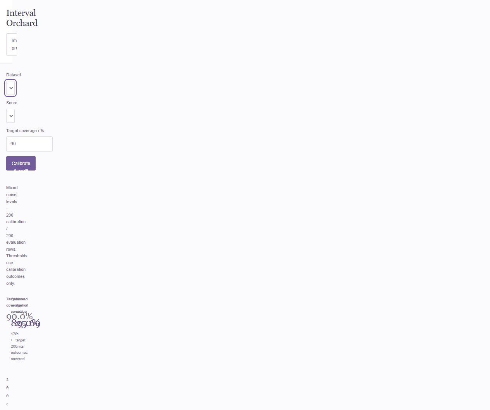

# Interval Orchard

A local split-conformal regression workbench. Import held-out predictions, calibrate uncertainty intervals, and inspect how coverage differs across groups and under distribution shift.



The audit puts individual prediction intervals beside a compact coverage summary. Group and miss filters sit above the plot; the plot scrolls independently for long evaluation sets. **Group audit & coverage curve** expands the secondary comparisons. Calibration assumptions and unbounded-interval notices stay visible alongside the results.

## Run

Requires Python 3.10+ to serve the app. No runtime packages or API keys.

```sh
python run.py --port 8000
```

Open http://127.0.0.1:8000/. Computation runs in a browser worker; imported data stays in the browser. Refreshing discards it unless you export a dataset.

## Workflows

- Compare absolute residuals against residuals normalized by positive predicted scales.
- Inspect individual intervals, filter groups or missed outcomes, and compare descriptive group coverage and widths.
- Explore fixed synthetic examples with heterogeneous noise, evaluation distribution shift, or too few calibration observations.
- Import CSV or dataset JSON; export complete interval CSV, audit JSON, or a reusable dataset.
- View the selected order statistic and coverage sweep instead of treating the interval as a black box.

[Example CSV](docs/example.csv) contains fictional generated observations. Required headers: `id,split,truth,prediction`. Optional: `scale` (default 1), `group` (default all). Splits must be `calibration` or `evaluation`, with globally unique IDs and both splits present. Limits: 10,000 observations, 30 groups, 2 MB files. Targets range from 50% to 99.9% in 0.1 percentage-point steps.

## Statistical contract

For n calibration scores and target coverage p, use the kth sorted score, where k = ceil((n+1)p). Scores are absolute residuals or absolute residuals divided by a supplied positive scale. Evaluation intervals are prediction ± threshold, multiplied by scale in normalized mode. No evaluation outcome influences calibration. If k exceeds n, the interval is explicitly unbounded; JSON uses null bounds plus `unbounded: true`, and CSV uses infinity markers.

The finite-sample guarantee is marginal under exchangeability, with the predictor and scale function fixed independently of calibration outcomes. This app does not train a model or verify those assumptions. IDs enforce record separation but cannot detect semantic leakage. Group summaries are descriptive, not group-conditional guarantees. A finite evaluation sample need not achieve nominal coverage; distribution shift can invalidate it. Choosing settings repeatedly using evaluation outcomes compromises their role as a final audit.

The implementation follows the split-conformal construction described in [Angelopoulos and Bates, A Gentle Introduction to Conformal Prediction](https://arxiv.org/abs/2107.07511). It is an evaluation and learning tool, not a substitute for deployment-specific validation.

## Verification

Requires Node.js 22+ for the core tests.

```sh
npm test
npm run check
python -m unittest discover -s tests -p 'test_*.py'
```

Twelve JavaScript tests cover exact finite-sample ranks, leave-one-out rank enumeration, ties, unbounded intervals, scale-sensitive widths, evaluation/calibration isolation, group totals, monotone sweeps, CSV syntax, validation, and exports. One Python test checks static-server boundaries. CI runs on Linux and Windows.

Browser checks cover scaled calibration, the explicit unbounded state, and CSV/JSON dataset imports. An independent Python calculation verified the exported rank, threshold, all 200 evaluation bounds, and 178 covered outcomes for the scaled example.

## Implementation

`core.js` contains pure validation and analysis; `worker.js` isolates computation; `app.js` owns rendering and file workflows. Worker revisions prevent stale results from replacing newer settings. SVG charts are bounded to 60 displayed rows; exports include every evaluation row. The server exposes only the app assets, with host checks and no directory listing.
